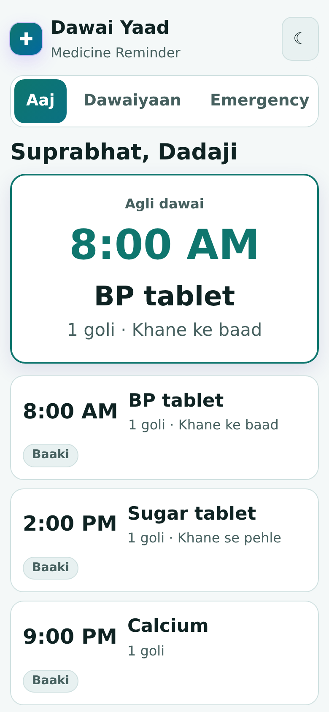
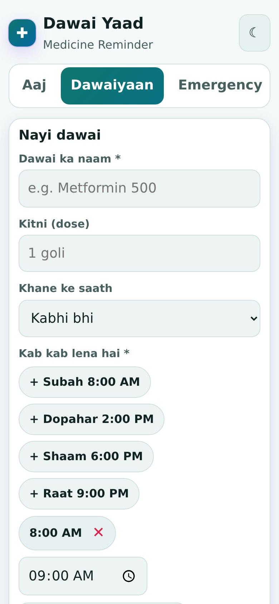
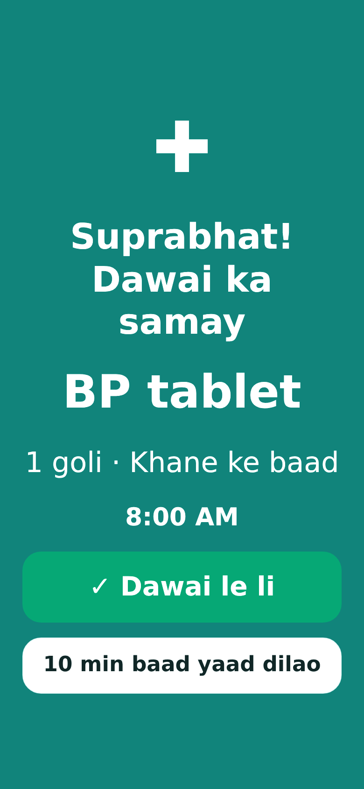
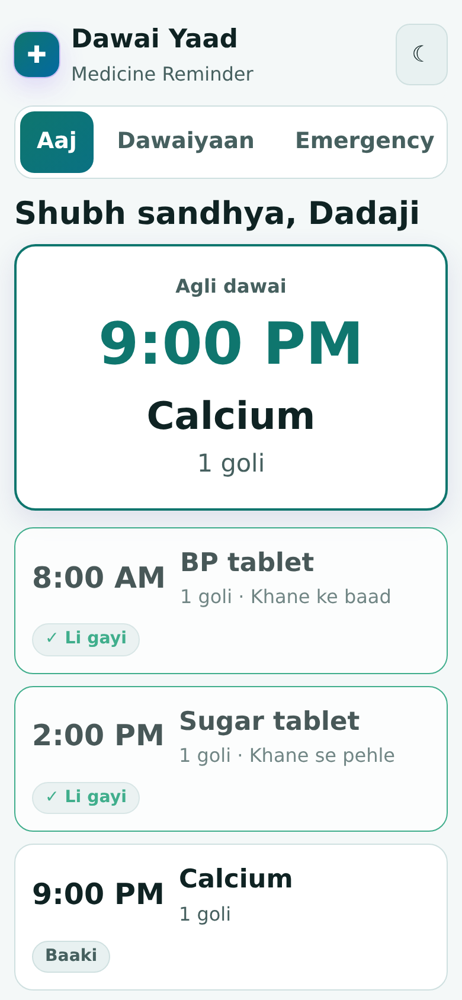
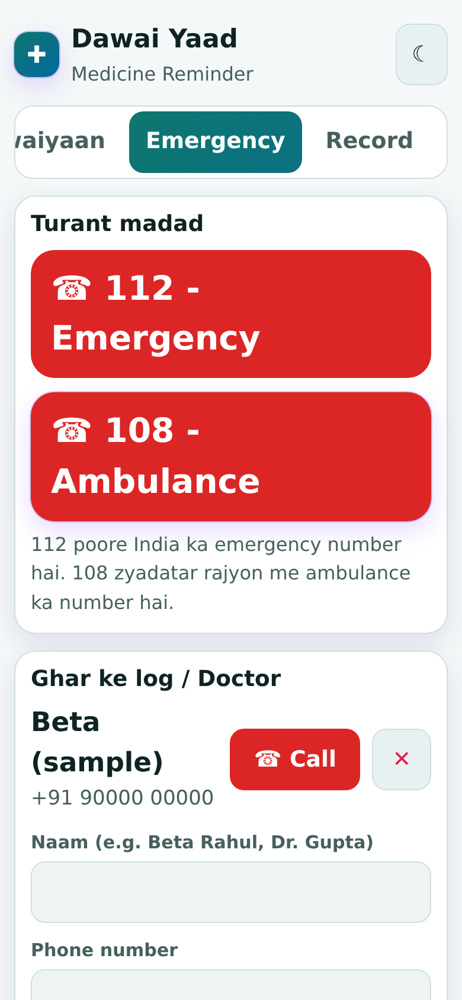
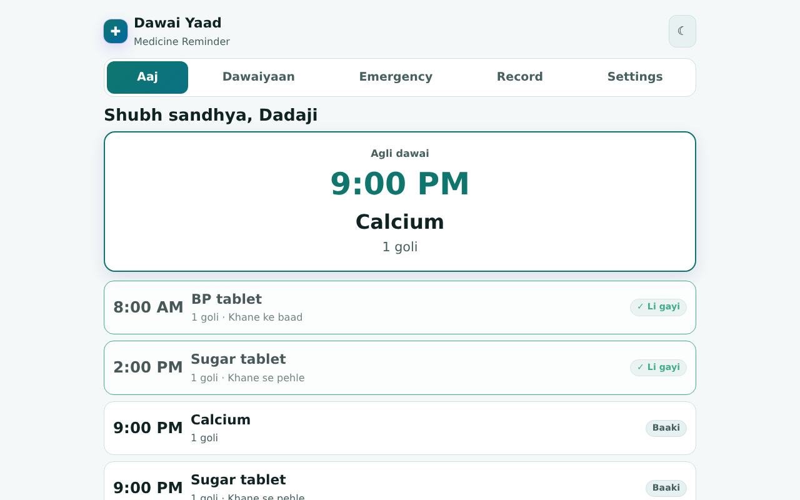

# Dawai Yaad - Elderly Medicine Reminder

Big-button medicine reminder for elders with voice alerts, taken/missed record and emergency call buttons.

**Live app:** https://akash991833.github.io/elderly-medicine-reminder-app/

Free, no sign-up, no ads. Works in the browser, offline after the first visit, and can be installed on your phone (Chrome menu > Add to Home screen / Install app). Everything is saved on your device only.

## Features

- Add medicines with dose, before/after food, one or more times a day and optional end date
- Today screen with a large "next medicine" card and one-tap "Dawai le li"
- Full-screen alert with beep and spoken reminder (Hindi or English), "remind me in 10 minutes" snooze
- Taken / missed record and a 7-day summary, printable for family
- Emergency tab: 112 and 108 call buttons, family and doctor numbers, medical info card (blood group, allergy, conditions)
- Text size: normal / large / extra large; dark and light mode
- JSON backup and restore; works offline, installable on phone

## How to use

1. Settings: enter the elder's name and choose text size and voice language.
2. Dawaiyaan tab: add each medicine and its times.
3. Keep the app open (or install it and enable "Screen on rakho") so the alert can ring.
4. Tap "Dawai le li" when taken. Missed doses show in red.
5. Emergency tab: add family and doctor numbers.

## Screenshots









## Good to know (limits)

- A web app cannot ring when the browser is fully closed or the phone is locked. Keep the app open (use "Screen on rakho" and a charger), or enable notifications for an extra nudge while the browser is running.
- Hindi voice needs a Hindi text-to-speech voice on the phone; otherwise the phone uses its default voice.
- This app is a reminder only. It gives no medical advice and does not replace the doctor's prescription.
- The numbers 112 (national emergency) and 108 (ambulance in most states) are standard in India; confirm for your state.

## Run it yourself

No build step. Clone the repo and open `index.html`, or serve the folder with any static server:

```bash
git clone https://github.com/AKASH991833/elderly-medicine-reminder-app.git
cd elderly-medicine-reminder-app
python3 -m http.server 8080
```

Plain HTML, CSS and JavaScript. No tracking, no external requests (fonts, scripts and data are all local).

## Privacy

No account, no server, no analytics. Data stays in your browser's local storage. Clearing browser data deletes it, so use the Backup option if it matters.

## License

MIT
